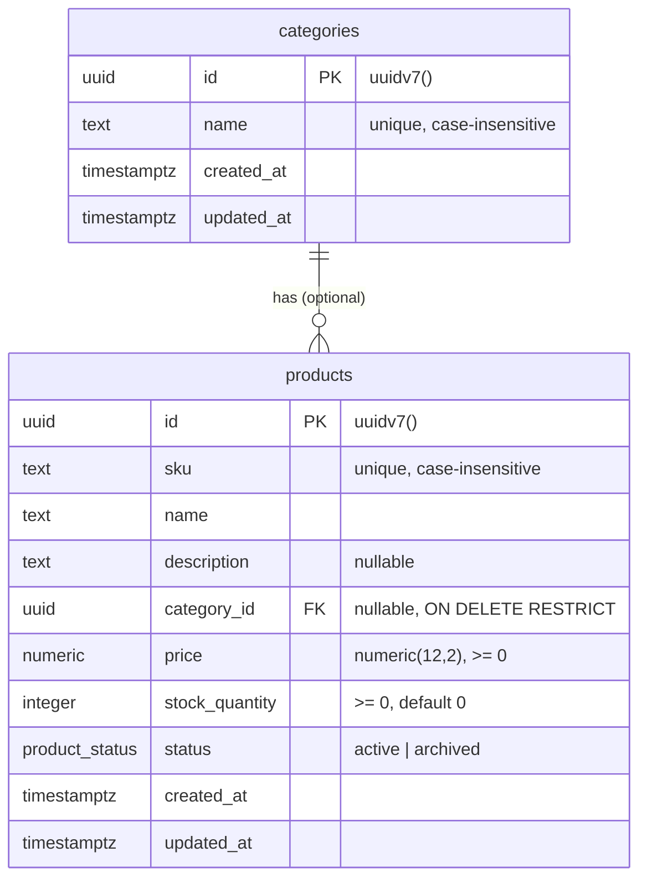

# Database

PostgreSQL 18, managed with Drizzle. Source of truth: `apps/api/src/db/schema.ts`. The applied SQL is in `apps/api/drizzle/`.

## Current ERD

## Planned tables

These come with their own slices, each in its own migration:

| Table | Purpose |
|-------|---------|
| `users` | Admin and staff accounts (M6) |
| `customers` | Who orders (M7) |
| `orders` | Order header, status lifecycle, server-calculated totals (M8) |
| `order_items` | Line items with a **price snapshot** taken at order time (M8) |
| `stock_movements` | Signed `quantity_delta` ledger: every stock change gets a row (M8/M9) |

## Constraints and why

| Constraint | Protects against |
|------------|------------------|
| `products_sku_lower_unique` (unique index on `lower(sku)`) | `ABC-1` and `abc-1` existing as two products |
| `categories_name_lower_unique` | Duplicate categories differing only by case |
| `*_not_blank` checks (`btrim(x) <> ''`) | Names and SKUs that are empty or whitespace |
| `products_price_non_negative` | Negative prices |
| `products_stock_non_negative` | Selling stock you don't have, even if app code has a bug |
| FK `category_id` with `ON DELETE RESTRICT` | Deleting a category silently orphaning or deleting products |
| `products_category_id_idx` | Slow joins and filters by category (Postgres doesn't index FKs automatically) |

## Seed data

`pnpm --filter @workshop/api db:seed` adds 4 categories and 11 products. It includes edge cases on purpose: a product with no category, a free product, items out of stock, a low-stock item, and an archived product. The seed can be re-run (existing rows are skipped), runs in a single transaction, and refuses to run when `NODE_ENV=production`.
